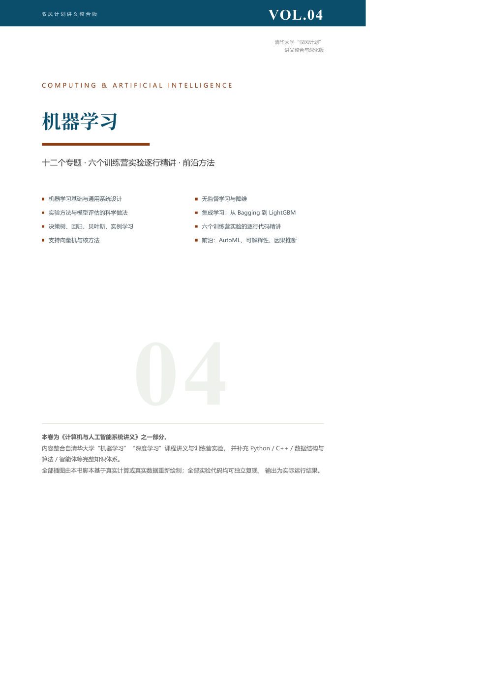
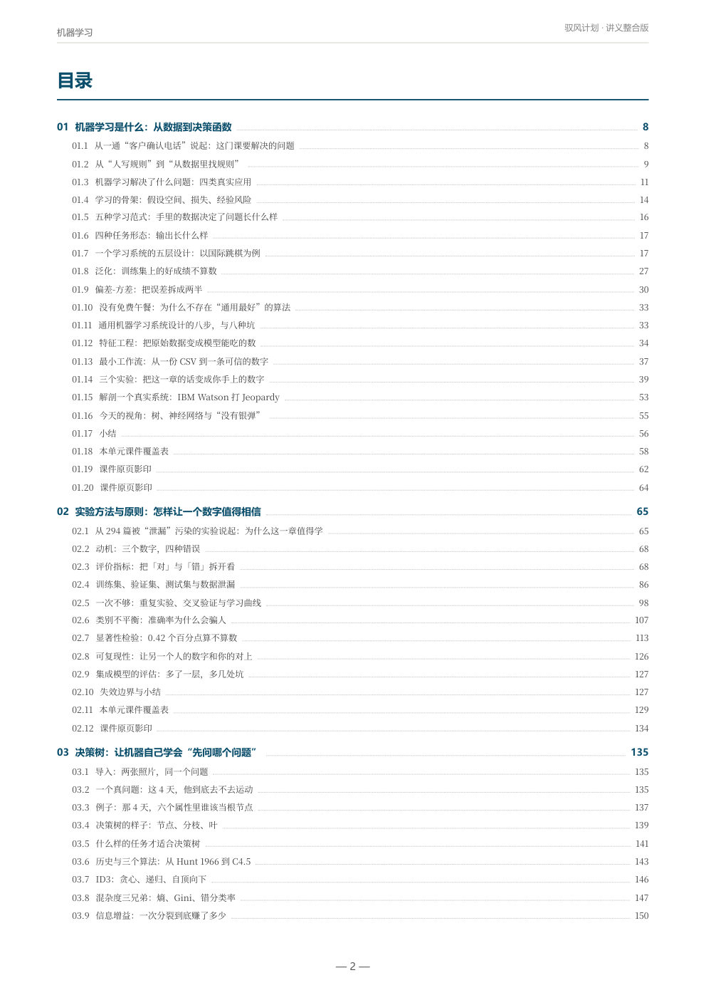
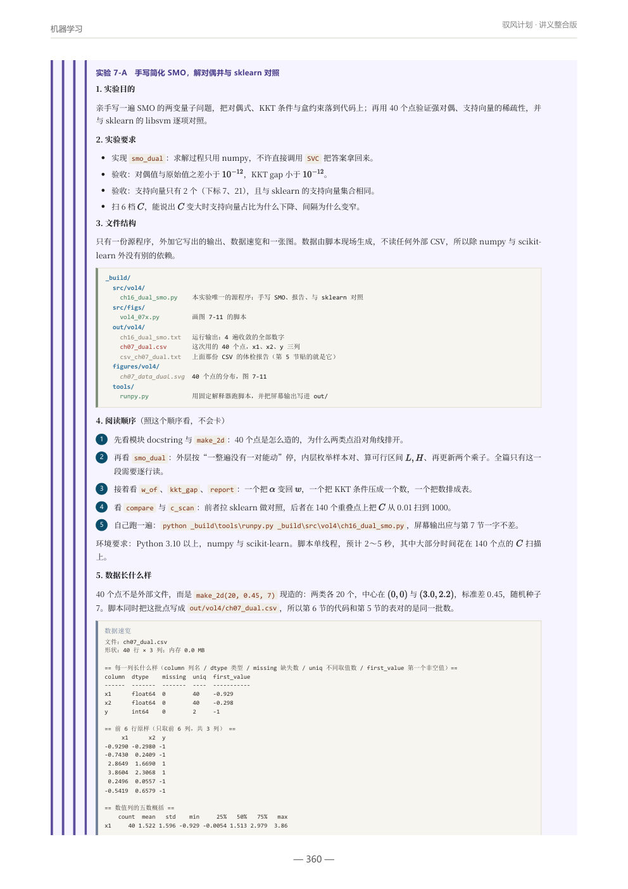

# material-to-book · 资料 → 讲义

把一个装满课件的文件夹，变成一本**能读、能跑、能对照**的书。

不是"总结工具"：它按学科逻辑重排内容，给每个实验配真实数据与真实输出，把工具函数讲进代码注释里，并在每章末尾附一张"原始材料每一页去哪了"的覆盖表。

> 本仓库同时是一个 **DSH skill**：装到 `~/.dsh/skills/material-to-book/` 后，直接对模型说"把这个文件夹整理成一份讲义"即可触发。


## 安装

```powershell
.\install.ps1            # Windows：装依赖 + 复制到 %USERPROFILE%\.dsh\skills + 体检
./install.sh             # macOS / Linux
```

装完的判据是 `scripts/doctor.py` 末行打印「结论：可以开工」。
细节（手动安装、指定解释器、升级、卸载、排错）见 [INSTALL.md](INSTALL.md)。


## 它会先问你（v2 新增）

一上来不读材料，先花十分钟问清四件事：**哪份是主线**、按什么顺序讲、写到多深、给谁看。因为"猜错方向"的代价是整本返工。

```bash
python scripts/intake.py "D:\课程资料"
```

它会把资料夹读成一张表（文件 / 页数 / 文字层 / 内嵌图 / 我看出的信号 / 角色判断＋置信度），打印一张 14 问的访谈卡（可直接整段发给用户），并写出 `_build/intake.json` 草案；答完用 `--apply` 合并进 `book.json` 的 `intake` 段。问法、默认值、学科档位表见 [`references/intake.md`](references/intake.md)。

## 长什么样



目录（注意每一章的「导入」「例子」「课件原页影印」「覆盖表」都在）：



实验页里有八节结构：目的 / 要求 / **文件结构树** / **阅读顺序** / **数据速览** / 逐段讲码：



## 它产出什么

| 类型 | 说明 |
|---|---|
| 多卷 PDF（默认） | A4 排版、封面、两级目录（页码回填）、书签、页眉页脚、真实图表、可跑代码；可合订成一册 |
| 单文件 HTML | 同一套章节片段，去掉分页，加侧边导航 |
| DOCX 报告 | 正文写 Markdown，交给 `office-docx` 生成 |
| PPT | 每章提炼 10~20 页，交给 `dsh-ppt` |
| Markdown 仓库 | `docs/NN_标题.md` + `assets/` |

## 它读什么

课件/讲义 PDF（含纯图片页）、Jupyter notebook（含损坏文件）、Python/C/C++ 源码、CSV/数据集、Markdown、Word、网页。

## 三条设计原则

1. **数字必须可追**：正文里每个统计量都由书内脚本跑出来，贴真实输出；不许估算。
2. **代码必须可跑**：代码只能通过 `INCLUDE-CODE` 引入，源文件真跑过；`def`/`class` 上方是中文 docstring（作用/参数/返回/关键实现/边界）。
3. **材料必须有归属**：每章末尾覆盖表把原始材料每一页映射到本书小节，不允许"不采纳"。
4. **要求必须可验收**：用户提过的 40+ 条要求逐条映射到文件与检查动作，见 `references/requirements.md`。

## 快速开始

```bash
# 1) 在资料夹里初始化一本书
python scripts/init_project.py "D:\课程资料" --title "XX 系统讲义" --volumes 3

# 2) 改 _build/book.json（卷名、封面要点、输出文件名）

# 3) 先写一个样板章，构建单卷试水
python _build/tools/build.py vol0

# 4) 按 references/prompts.md 分派子代理，逐章写

# 5) 质检 → 全量构建 → 合订
python _build/tools/checkbook.py
python _build/tools/build.py all
python _build/tools/build.py merge
```

## 目录

```
SKILL.md                 # 给模型看的完整说明书（工作流、规范、验收）
scripts/                 # 23 个可直接跑的脚本
  intake.py              #   阶段 −1：扫文件角色 + 访谈卡 + intake.json
  init_project.py        #   初始化 _build/
  build.py               #   HTML 片段 → PDF → 页码/书签 → 合订
  extract_sources.py     #   PDF / ipynb 抽取
  pgs.py                 #    PDF 指定页 → PNG（人眼读图）
  csvpeek.py             #   CSV 体检报告
  runpy.py / runcc.py    #   跑 Python / 编译跑 C-C++
  docstringify.py        #   注释块 → docstring
  preview.py checkbook.py numcheck.py fix_lt.py scan_latex.py verify_book.py
  renumber.py fixrefs.py cwembed.py v3check.py cwaudit.py finalize.py …
assets/book.css          # A4 排版样式（页眉页脚、代码条、树状图、数据块）
references/
  intake.md              # 十四问访谈、学科默认档位、派生参数
  pipeline.md            # 构建细节与 book.json
  style-guide.md         # 写作规范（深度四层、语言、公式、图表）
  experiment-spec.md     # 实验八节 + docstring 四段 + 代码关系
  requirements.md        # 40+ 条要求的逐条对照表（含验收动作）
  chapter-template.html  # 可复制的章节骨架
  qa-checklist.md        # 质检清单
  prompts.md             # 子代理 prompt 模板
  lessons.md             # 22 条踩坑
examples/book.example.json
```

## 依赖

- Python 3.12：`pymupdf`、`matplotlib`、`numpy`、`pandas`、`pygments`；跑 C/C++ 另需 `ziglang` 或系统 gcc/g++。
- Edge 或 Chrome（无头打印 PDF）。
- 中文字体：正文 Noto Serif SC，图 Microsoft YaHei（Linux 可换 Noto Sans CJK）。
- 不需要 LaTeX，也不需要 LibreOffice。

## 已知边界

- 只对"有文字层或可渲染成图"的 PDF 有效；加密 PDF 需先解密。
- 目录页码回填依赖"标题注入标记"，因此正文里不要手写 `ZZQ…ZZ` 这类字符串。
- Windows 上会遇文件锁，`build.py` 已内置重试与改名策略。
- 大型数据集（>1GB）只做抽样体检，不整份入书。

## 它是怎么长出来的

这不是凭空设计的一套规范，而是一个真实项目里被逐条要求磨出来的：把清华"驭风计划"的机器学习、深度学习讲义与训练营实验，连同 Python / C++ / 数据结构 / Agent 一起，做成一套合订讲义。

| 指标 | 数字 |
|---|---|
| 合订本 | **2252 页**，7 卷，946 条书签 |
| 正文 | 约 **96 万字**（首版 1495 页 → 逐轮深化到 2252 页） |
| 图 / 表 | 747 图（其中 **330 张是原课件页影印**）、700 表 |
| 实验 | **123 个**，其中 72 个按八节重写（文件树 + 阅读顺序 + 数据速览 + 逐行讲码） |
| 代码 | 全部由脚本真跑，输出贴进书里；`def` 全部有中文 docstring |
| 覆盖表 | 21 个 ML + 10 个 DL 课件共 1221 页，逐页映射，**0 条"不采纳"** |

过程中踩的坑都记在 `references/lessons.md`（22 条），规范冲突时的优先级写在 `SKILL.md` 与 `references/requirements.md`。

## License

MIT，见 [LICENSE](LICENSE)。

## 作为一个 DSH 组合包安装（可选）

仓库自带 `package.json` + `cordis.patch.yml` + `lib/index.js`，所以它同时是一个 **bundle**（组合包）和一个 **技能提供者**：装进 profile 后，技能页面直接出现 `material-to-book`，不需要再复制到 `~/.dsh/skills`。

装法有三种，任选一种：

| 场景 | 做法 |
|---|---|
| 只想给自己用 | 把本仓库克隆到 `~/.dsh/skills/material-to-book`（或跑 `install.ps1`），不需要组合包 |
| 有插件市场索引 | 插件页「发现」→ 添加索引源，填 `https://raw.githubusercontent.com/Wei-yf32/material-to-book/main/market-index.json`，然后装 `dsh-skill-material-to-book` |
| 手动装本仓库 | 在 profile 目录里 `pnpm add git+https://github.com/Wei-yf32/material-to-book.git#<commit>`，再把 `dsh-skill-material-to-book` 加进 `package.json` 的 `dsh.profile.bundles` |

装成组合包后，如果 `~/.dsh/skills/material-to-book` 还在，同名技能会出现两份，只有一份生效（打包技能优先级 600）。要去掉重复，删掉那个目录即可——插件里的副本带同样的 `scripts/`、`references/`，功能一致。
